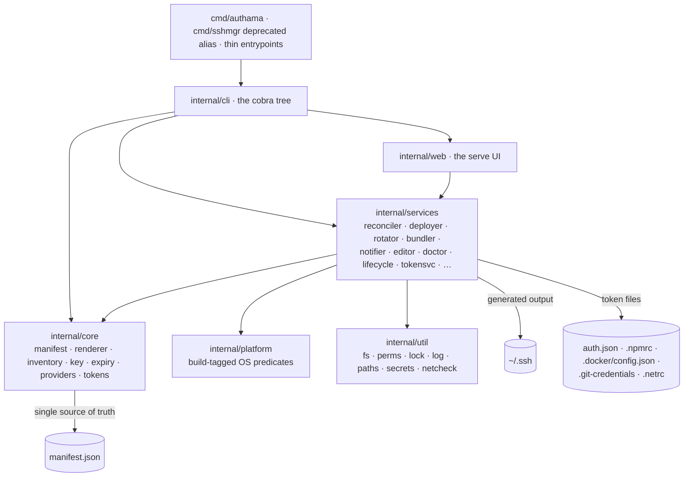
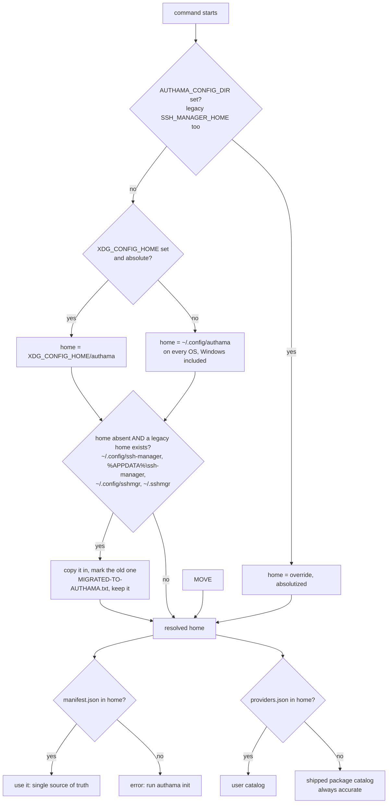
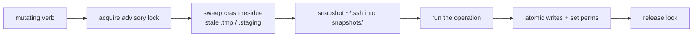
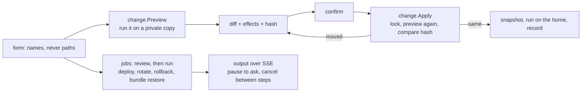
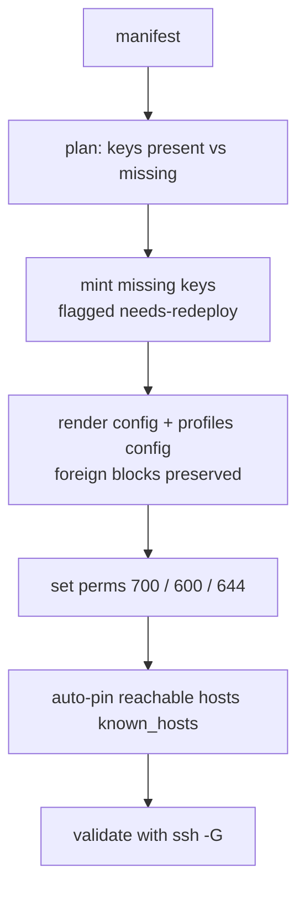
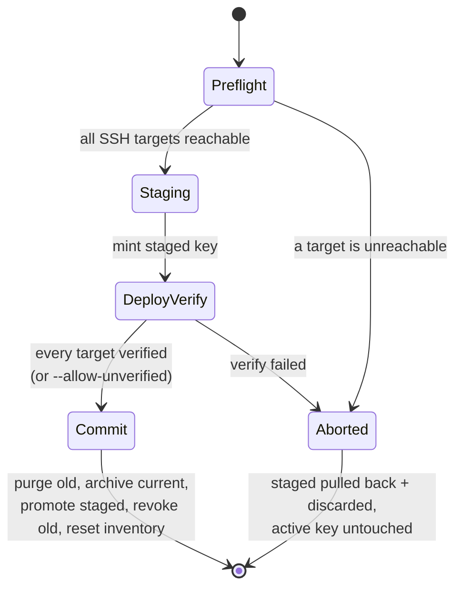

# Architecture



There is no facade. `internal/cli` is where composition happens, and it is a
leaf: nothing under `internal/` imports it. `internal/core` is the domain and
depends on nothing above it. Both directions are asserted by
`src/cmd/authama/layering_test.go`, along with a ceiling on methods-per-type - the
Python version's facade type carried 54 and every verb hung off it.

The repository has two roots. Everything the Go toolchain reads lives under
`src/`, which is the module; everything the repository presents - README,
LICENSE, CHANGELOG, `docs/`, `.github/` - stays at the top. Build output is a
property of the repository rather than of the module, so there is one `build/`
at the root and not one per module.

```
src/                # THE GO MODULE. go.mod is here, so every `go` command runs
                    #   here - the Makefile uses `go -C src` for exactly this.
  cmd/authama/      # thin entrypoint; calls internal/cli and nothing else. Also
                    #   holds the repo-wide invariant tests (layering, hygiene, e2e)
  cmd/sshmgr/       # the deprecated alias: the same program under its former name,
                    #   printing a one-line deprecation notice on stderr
  internal/
    cli/            # the cobra tree, one file per verb. The ONLY package that
                    #   imports cobra, and the only place services are composed.
                    #   exit.go owns the exit-code contract; mutate.go the guard.
    brand/          # the names: display name, command, legacy command
    core/           # pure domain: manifest, renderer, inventory, key, expiry,
                    #   authkeys, providers (adapters + the embedded catalog),
                    #   tokens (the five credential formats; no I/O)
    services/       # use-cases, one concern each: reconciler, configsvc, importer,
                    #   deployer, rotator, notifier, bundler, editor, knownhosts,
                    #   query, keystore, agent, preflight, doctor, snapshots,
                    #   validate, recover, initsvc, migratesvc, netstat, keyaudit,
                    #   keysvc, lifecycle, tokensvc (token I/O), change (the
                    #   web UI's previewable changes), history, jobs, settings,
                    #   cleaner (stale pins and records), dockerctx (VM Docker
                    #   contexts), gitremote (a checkout's origin transport),
                    #   opstore (keys kept in 1Password), overview (the TUI
                    #   banner and web overview), pubkeys (regenerate .pub)
    platform/       # build-tagged OS predicates and terminal handling
                    #   (*_darwin.go, *_linux.go, *_windows.go, *_other.go)
    web/            # serve: routes, templates, the preview/confirm engine
    util/           # fs, perms, lock, log, paths, secrets, netcheck, scheduler,
                    #   homeperms, askpass, httpjson, desktop
  config/           # the shipped example manifest/inventory, the providers
                    #   catalog, and the JSON schemas. providers.json here is
                    #   byte-identical to the copy embedded in the binary.
  scripts/          # install.sh, install.ps1, build-all.sh, extract-changelog.sh
                    #   - the four artifacts that must stay shell
  .goreleaser.yaml  # release config; runs from the repo root (see below)
  .golangci.yml
build/              # everything build-related, and the only place anything is
                    #   generated. targets.txt (the release matrix) is the one
                    #   tracked file; build/authama and build/sshmgr (the alias) are `make build` output and
                    #   build/dist/ is GoReleaser's. `make clean` empties it.
docs/  README.md  CHANGELOG.md  LICENSE  Makefile  .github/
```

Package paths below are written relative to the module, so `internal/cli` is
`src/internal/cli` on disk; the Go import path is
`github.com/simtabi/authama/src/internal/cli`.

Two paths deliberately cross that boundary, and both are commented where they
occur. GoReleaser runs from the repo root with `builds[].dir: src`, because its
archive globbing will not climb out of its own working directory to reach
LICENSE and README. And `build-all.sh` runs from the module - `go build` needs
that - while writing into the repo-root `build/`.

One third-party dependency: `github.com/spf13/cobra`. That is asserted, not
aspirational - there is nowhere for a presentation or HTTP library to hide.

## Auth tokens

The token feature follows the same layering as the SSH side:

- `internal/core/tokens` is pure. It turns a config and the current file text
  into new file text (render, merge, read back, remove), validates targets and
  values, and carries the Composer service catalog and the starter templates.
  Its rendering is checked byte-for-byte against golden files produced by the
  Python auth-token-manager it was ported from.
- `internal/services/tokensvc` does the I/O: finding the config, reading and
  writing the five files atomically at 0600, `docker login` for registries in a
  credential store, `.gitignore` checks, the shell-alias block, and audit and
  history records that name the target and host but never the secret. Its `Env`
  is built once per command; in dev mode it maps every path into the sandbox
  and hides the tools' own path variables, so a test or a `--dev-root` run
  cannot reach the real files.
- `internal/cli/token.go`, `token_more.go` and `tui_tokens.go` are the `token`
  group and the TUI's Auth tokens menu; `internal/services/change/tokens.go` and
  the web Tokens page make delete and apply previewable like every other web change.
- `doctor` reads token-file modes through `tokensvc`, warns on a loose one (fails
  under `--strict`) and repairs them with `--fix`.
- `docs/reference/cli.md` is generated from the command tree, and a test fails
  when it is stale or when a command has no example that parses.

Names (`Authentication Access Manager`, `authama`, the deprecated `sshmgr`) come from
`internal/brand`, so a rename is one edit. Environment variable names come from
`internal/util/envnames`: each `AUTHAMA_*` name lists its pre-0.1.1 spellings
(`SSH_MANAGER_*`, `SSHMGR_*`), which are still read with a one-line deprecation
notice. The Go module path is unchanged.

## Key flows

### Startup: homes, .env and authama.json

Every command except `help`, `version` and `completion` runs the same startup
before it does anything else (`internal/cli/startup.go`):

1. Resolve the config home and the state home (below).
2. On the first run only, copy a pre-0.1.1 home into the new one
   (`internal/services/migratesvc`).
3. Load `<config home>/.env` into the process environment, never over a
   variable that is already set under any spelling (`internal/services/settings`).
   Skipped by `--no-dotenv` or `AUTHAMA_NO_DOTENV=1`; refused when the file is
   readable by group or others.
4. Load `<config home>/authama.json`, validate it against its schema, and apply
   whatever is still unset. An invalid file stops the command with every problem
   listed.

So the precedence is: flags > real environment > `.env` > `authama.json` >
built-in defaults.



### Mutation guard (wraps every state-changing verb)



### Web UI: preview, confirm, or run as a job

`authama serve` (`internal/web`) reads the home through one `Engine`, and makes changes through two
services that the CLI's own code paths sit behind:



- **A preview is the change, made somewhere harmless.** `services/change` copies the config files
  and every file a snapshot may hold into a temporary home, with an empty placeholder wherever a
  private key is, runs the change there, and diffs the result. Files it holds only as placeholders
  are listed by path when a change removes or creates them. Work a copy cannot hold - a Docker
  context, a notification, an encrypted backup - runs on apply only, and is listed beforehand.
- **A confirmation is bound to a hash** of the change, the state it was computed from, and what it
  will do. Apply takes the lock, previews again, and stops if the hash moved.
- **Jobs** (`services/jobs`) are the changes that reach other machines. They run one at a time,
  under the lock for as long as they run, with stdin closed and `BatchMode=yes` for ssh.
- **One change at a time per process.** Previews, changes and jobs share one slot
  (`mutation.Exclusive`), and each operation is scoped (`mutation.Scoped`): it takes the lock, opens
  its history record, and releases both when it ends. The CLI keeps its once-per-process lock; the
  menu releases it after each change.

### reconcile: manifest to ~/.ssh



### rotate: zero-downtime, single-old-archive



## One config, one trust store, keys under the profile

`~/.ssh` is **generated output**. Everything belonging to one identity sits under
that identity's profile directory, and nothing crosses profiles:

```
~/.ssh/
├── config                          # 600 - A marked managed block holds every
│                                   #   uncategorized Host entry, grouped by profile
│                                   #   banner, one Include per category, and
│                                   #   `Host *` last. Foreign content outside the
│                                   #   markers is preserved verbatim.
├── known_hosts                     # 600 - ONE hashed trust store. Lines this tool
│                                   #   pinned carry an `authama` comment tag (`sshmgr`
│                                   #   before 0.1.2), so it only ever prunes its own.
└── profiles/
    ├── work/                       # an uncategorized profile: keys only
    │   ├── work_hpc-ed25519        # 600 - private key, never leaves the machine
    │   ├── work_hpc-ed25519.pub    # 644 - public key
    │   ├── old/                    # <=1 archived predecessor per key (rotation)
    │   └── .staging/               # transient, only mid-rotation
    ├── personal/  ...  (github.com via its own key)
    └── orgs/                       # a category
        ├── config                  # 600 - rendered Host blocks for the category
        └── acme/                   # github.com again, but a SEPARATE key
            └── acme_github-ed25519.pub   # key_store 1password: .pub only
```

Per-profile isolation is enforced by the rendered config, not by the file layout:

- `IdentityFile ~/.ssh/profiles/[<category>/]<p>/<key>` plus **per-host** `IdentitiesOnly yes`
  means a host is only ever offered **its own** key. No cross-offer, and no
  lockout from an agent volunteering five keys before the right one.
- Perms are load-bearing (dirs 700, private keys and the config 600, public keys
  644), set on create and re-asserted by `doctor` and `reconcile` - which walk the
  same enumeration, so they cannot disagree about what is managed.

> `known_hosts` is 600, not the conventional 644. ssh has never needed the trust
> store world-readable, and its contents are an inventory of every host you
> connect to - which is also why the names in it are hashed.

The manifest is the single source of truth; `reconcile` regenerates this whole
tree from it (and `restore` brings the same keys back from an age bundle).

## Patterns

- **Strategy** — `internal/core/providers` (deployment adapters) and
  `internal/platform` (OS behaviour, selected by build tag rather than at runtime).
- **Repository** — `Manifest` and `Inventory` load and save atomically.
- **Command** — one CLI verb per use-case, composed in `internal/cli`.

There is deliberately no facade. See *Why is there no single service object?* below.

## Load-bearing rules

- **One renderer.** `config render`, `config check` and `reconcile` all call
  `internal/core/renderer`. `check` renders to a buffer and compares byte for
  byte, so the verifier and the writer can never disagree.
- **Atomic + locked state.** Every state and config write goes through
  `internal/util/fs` (temp file, then rename over) under `internal/util/lock`.
  Both `manifest.Save` and `inventory.Save` claimed this while using
  `os.WriteFile`, which truncates first and keeps whatever mode the file had;
  both are now genuinely atomic and both re-assert 0600.
- **Perms through one chokepoint.** `internal/util/perms.SetPerms` is the single
  place modes and ACLs are applied; `perms.ModeFor` owns the path-to-mode policy
  and `perms.IterManagedPaths` is the one enumeration both the fixer and the
  checker walk.
- **Subprocess policy.** Every external command is an argv slice, never a shell
  string. The tool's entire external-binary surface is pinned by a test, so a new
  shell-out has to be declared.
- **One mutation at a time.** The advisory lock is held for the whole mutating
  verb, including provider network calls in `deploy`, `rotate` and the deletes, so
  a single-user run is serialised and cannot interleave. Every `ssh`, CLI and HTTP
  call is hard-timeout-bounded, so a slow provider blocks other invocations only
  for that bounded window, never indefinitely. The lock is taken once per process,
  not once per call: `flock` is per descriptor, so a second acquire in the same
  process waits forever on a lock that process is already holding.

## Why the layout is what it is

### Why one inline config and one `known_hosts`?

The Python version wrote a `config` and a `known_hosts` per profile and stitched them together
with `Include`. That put the trust store's isolation in the file layout, which
made it fragile in two ways: `Include` ordering is subtle enough that a
hand-edited file could silently stop applying, and a per-profile store meant the
same host key was verified and stored several times over.

The isolation that actually matters — a host is only ever offered its own key —
comes from `IdentityFile` plus a **per-host** `IdentitiesOnly yes`, which the
rendered config states explicitly for every host. So the guarantee is
stronger and the layout is simpler. The one trust store is hashed, and every line
this tool writes carries an `authama` comment tag (`sshmgr` before 0.1.2, still
recognized) so pruning only ever removes its own.

This is the one place the Go implementation deliberately does not match the Python version's
output. Everything else does.

### Why do categories use `Include` when everything else is inline?

A category is a grouping someone asked to see as a file: client accounts in one
place, internal ones in another. That is a layout choice, not an isolation
mechanism, so it does not reopen the argument above. Isolation still comes from
`IdentityFile` plus per-host `IdentitiesOnly`, written into every block wherever
the block lives.

The ordering hazard that retired the Python version's per-profile Includes is handled
explicitly. The Includes sit at the top of the managed block, ahead of every
inline host and `Host *`, and open with `Match all` so they stay global when
foreign content above the block ends inside a `Host` stanza. A test runs
`ssh -G` against both forms, so the reason is pinned to OpenSSH.

Every path to a key goes through `Manifest.ProfileDir` / `KeyPath`, and a
layering test fails any `filepath.Join` that builds `profiles/<computed>` by hand.
That is the defect categories expose: a hand-built path is right for a flat
profile and silently one directory too high for a categorized one.

### Why can keys live in 1Password, and why per profile?

A key file on disk is only as safe as the disk, and every copy of `~/.ssh` (a
backup, a bundle, a laptop) carries it. With `key_store: 1password` the private
key is generated inside 1Password and never read back: authama writes only the
public half, and ssh reaches the key through the 1Password agent, selected by
that `.pub` with `IdentitiesOnly`. Rotation, the part people skip, stays one
command, and the vault keeps every predecessor in its Archive.

The store is a profile setting, not a host one, because a key is shared by its
profile's hosts: a per-host field could have two hosts disagree about where one
key lives. Nothing else about a key changes with its store: its name, its
inventory record and its `IdentityFile` identity are the same, so moving a
profile between stores is a rotation, not a migration of state.

### Why is there no single service object?

The Python version had a `SshManagerService` facade: 1356 lines, 54
methods, every verb hanging off it. It was the natural place for logic to
accumulate, and it did. `internal/cli` composes services directly instead, and a
test enforces the shape — a ceiling on methods per type, plus the two dependency
directions (nothing under `internal/` imports `internal/cli`; `core` never
imports `services`).

Services composing one another is fine and expected: `reconciler` needs
`keystore`, `doctor` needs `preflight`. That is layering, not a God object.

### Why does the web UI preview a change by making it?

A description of a change is a second implementation of it, and the two drift: the preview says one
thing and the change does another. Running the real change against a copy shows exactly what it
writes, through the same code the CLI runs, and the parity test holds every web change to its CLI
command byte for byte. The copy holds no private key, so a preview cannot leak one. What a copy
cannot show - private keys, Docker contexts, notifications, other machines - is listed instead, or
runs as a job, where nothing is previewed and the output is shown as it happens.

### Why is the TUI a plain menu?

The Python version used `rich` and `questionary`. The Go binary has one third-party dependency,
`cobra`, and no presentation library — so output is plain text that a pipe can
read and the TUI is a numbered stdin menu rather than a full-screen application.
That is a real loss of polish and a real gain in portability: nothing to render,
nothing to detect, and every command's output is machine-readable by default.

### Why does a `key_name` repeat across profiles?

The Python version rejected a manifest where two profiles declared the same key name. One person
working under two organisations uses the same file name in both, so that ban
prevented a normal setup. A key's identity here is the pair `profile/key`, not
the bare name — which is also why `keygen --force` confirms per key rather than
per name.

### Why does the passphrase go through askpass?

`ssh-keygen -N <passphrase>` puts the secret in the command line, where any local
user can read it out of the process list. It is handed over through the askpass
protocol instead, and offered on stdin for pre-8.4 versions that read it there.

### Why does `GenericSSH` fall back to plain `ssh`?

Microsoft's OpenSSH port does not ship `ssh-copy-id`. `ssh-copy-id` is a shell
script around one command, so the fallback does the same thing — same modes, same
dedupe, same result — and on Windows it is the normal path rather than a fallback.

### Why does `agent load` skip a key no host uses?

An agent holds keys for connections. A key a profile declares that no host
references serves no connection, and loading it would offer an extra identity to
every server you subsequently talk to. This differs from `reconcile`, `validate`
and the dangling-key audit, which all deliberately do consider unwired keys —
those are asking "does this key exist and is it healthy", which is a different
question.

## Platform layer

`internal/platform` answers OS questions through build-tagged files rather than a
runtime switch, so each platform's code only exists where it can run.
`EmitUseKeychain` decides whether the renderer emits the macOS-only `UseKeychain`
line. **macOS, Linux, and Windows are all
first-class.** Each is validated on its own CI runner: Linux (systemd-user timer /
cron scheduler, `notify-send`), and Windows (`icacls` owner-only ACLs, `schtasks`,
PowerShell toast). The Windows leg matters: it is the only place the tagged code
runs at all, and the first time it did it found four defects nothing else could
see - a test home that was never isolated there, an advisory lock that leaked its
descriptor, and two mode assertions with no ACL guard.

## Why is the web UI's JavaScript ES modules with no build step?

The web UI's script is a few small ES2022 modules under `src/internal/web/assets/`: `app.js`, the
entry point, and `js/core/` and `js/components/`. They are plain JavaScript with JSDoc types, and
`e2e/web/tsconfig.ui.json` checks them under TypeScript's strict mode in CI (`make e2e-web`), so they
are typed without a compiler step between the source and the binary: what is reviewed is what is
embedded.

- **`El`** builds and changes elements fluently and only through DOM calls, so nothing is parsed as
  HTML and the CSP's ban on inline script and style holds.
- **`Options`** reads a component's settings from data attributes, typed by its defaults:
  `data-table-page-size="25"` is `pageSize: 25`.
- **`Component`** is the base class: a subclass names its data attribute and defaults, and `mount`
  builds one instance per marked element, once.
- **`App`** registers and starts them: `App.create().use(DataTable).use(ConfirmAction).start()`.
- **Components** - `DataTable` (sort, search, page size, pages; chainable: `sortBy(2,
  "desc").search("github").render()`), `ConfirmAction`, `AutoSubmit`, `JobStream` - each take their
  markup and options from data attributes, so a page opts in by markup alone.

The server serves `app.js` and everything under `js/` under one fingerprint taken over all of them,
so a relative `import` resolves under the same `/assets/<hash>/` path, and any change to any module
moves them all. Every page works without the script; it only adds conveniences.

---

[← Docs index](../README.md#documentation)
